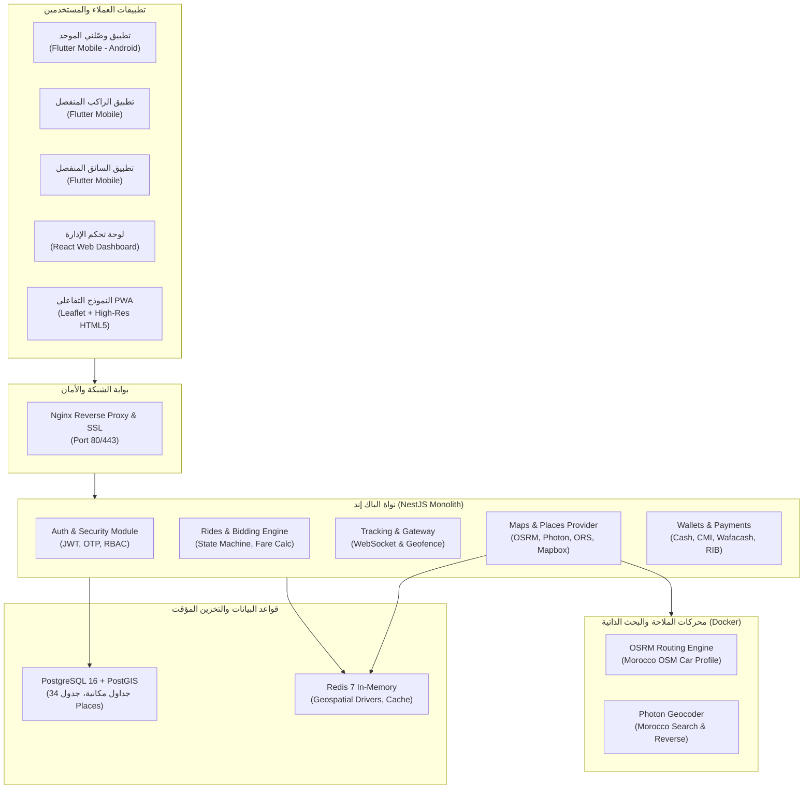

# 🚗 مشروع وصّلني المغرب (Wasslni Morocco) — الدليل الشامل والتوثيق التقني المفصل 🇲🇦

[](https://github.com/theday01/wasslnima/actions/workflows/ci-cd.yml)
[](https://github.com/theday01/wasslnima/releases/tag/v1.0.0)
[](https://opensource.org/licenses/MIT)
[](https://flutter.dev)
[](https://nestjs.com)
[](https://postgis.net)
[](https://redis.io)

**منصة وصّلني (Wasslni)** هي منظومة نقل ذكي مغربية متكاملة 100% تعتمد نموذج التفاوض المباشر والحر على الأسعار (Ride-Hailing & Bidding Model على غرار inDrive)، مصممة بهوية بصرية مغربية فاخرة (**الأخضر الزمردي `#0B3D2E` والذهبي الملكي `#C9A24B`**)، وتعمل بوضع نهاري افتراضي ناصع ومريح للعين مع تجربة استخدام محلية بالدارجة المغربية، العربية، الفرنسية، وتيفيناغ.

---

## 📑 فهرس المحتويات
1. [روابط تحميل التطبيق المباشرة (APKs)](#-روابط-تحميل-التطبيق-المباشرة-apks)
2. [الفلسفة ونموذج العمل (Business Model)](#-الفلسفة-ونموذج-العمل-business-model)
3. [التطبيق الموحد (All-in-One Architecture)](#-التطبيق-الموحد-all-in-one-architecture)
4. [هندسة الخرائط وحل المشكلات الجذرية](#-هندسة-الخرائط-وحل-المشكلات-الجذرية)
5. [المعمارية التقنية للمنظومة (System Architecture)](#-المعمارية-التقنية-للمنظومة-system-architecture)
6. [هيكل المستودع البرمجي (Monorepo Layout)](#-هيكل-المستودع-البرمجي-monorepo-layout)
7. [شاشات وواجهات المستخدم (UI/UX Modules)](#-شاشات-وواجهات-المستخدم-uiux-modules)
8. [الباك إند والخدمات المصغرة (Backend & APIs)](#-الباك-إند-والخدمات-المصغرة-backend--apis)
9. [قاعدة البيانات وجداول المعالم (Database & Spatial Places)](#-قاعدة-البيانات-وجداول-المعالم-database--spatial-places)
10. [البنية التحتية والتشغيل بـ Docker](#-البنية-التحتية-والتشغيل-بـ-docker)
11. [خط الأنابيب السحابي للبناء المؤتمت (CI/CD Pipeline)](#-خط-الأنابيب-السحابي-للبناء-المؤتمت-cicd-pipeline)
12. [دليل التشغيل والتطوير المحلي (Quick Start)](#-دليل-التشغيل-والتطوير-المحلي-quick-start)
13. [الأمان والامتثال للقوانين المغربية (CNDP & Law 09-08)](#-الأمان-والامتثال-للقوانين-المغربية-cndp--law-09-08)

---

## 📥 روابط تحميل التطبيق المباشرة (APKs)

تم بناء وتوقيع حزم التطبيقات السحابية عبر خط الأنابيب المؤتمت وإتاحتها للتحميل والتثبيت المباشر:

| الحزمة البرمجية | الحجم | نوع الحزمة | الرابط المباشر من GitHub Releases | المسار المحلي بالحاسوب |
| :--- | :---: | :---: | :---: | :---: |
| 🌟 **تطبيق وصّلني الموحد (`wasslni.apk`)** | **20.6 MB** | **تطبيق شامل (راكب + كابتن معا)** | [📥 تحميل `wasslni.apk`](https://github.com/theday01/wasslnima/releases/download/v1.0.0/wasslni.apk) | [`release-apks/wasslni.apk`](file:///d:/scripts/19-%20like_IN-Driver/release-apks/wasslni.apk) |
| 👤 **تطبيق الراكب المنفصل (`wasslni-rider.apk`)** | **20.5 MB** | مخصص للركاب فقط | [📥 تحميل `wasslni-rider.apk`](https://github.com/theday01/wasslnima/releases/download/v1.0.0/wasslni-rider.apk) | [`release-apks/wasslni-rider.apk`](file:///d:/scripts/19-%20like_IN-Driver/release-apks/wasslni-rider.apk) |
| 🚖 **تطبيق السائق المنفصل (`wasslni-driver.apk`)** | **19.6 MB** | مخصص للكباتن فقط | [📥 تحميل `wasslni-driver.apk`](https://github.com/theday01/wasslnima/releases/download/v1.0.0/wasslni-driver.apk) | [`release-apks/wasslni-driver.apk`](file:///d:/scripts/19-%20like_IN-Driver/release-apks/wasslni-driver.apk) |

> 🔗 **صفحة الإصدارات الكاملة**: [Wasslni Releases v1.0.0](https://github.com/theday01/wasslnima/releases/tag/v1.0.0)

---

## 💡 الفلسفة ونموذج العمل (Business Model)

1. **نموذج التفاوض الحر (Freedom of Bidding)**:
   - الراكب يدخل نقطة الانطلاق والوجهة ويقترح السعر المناسب له بالدرهم المغربي (MAD).
   - يتلقى السائقون القريبون الإشعار، ويمكنهم قبول السعر المقترح بضغطة زر أو تقديم عرض مضاد (Counter-offer).
   - يختار الراكب السائق بناءً على: السعر، تقييم السائق، طراز السيارة وسنة الصنع، وزمن الوصول الفعلي (ETA).
2. **برنامج عمولة 0% الترويجي للكباتن**:
   - يحصل كل سائق يسجل في المنصة على **شهرين مجاناً بدون أي عمولة (0%)**، ويبدأ العداد التنازلي الترويجي من أول رحلة مكتملة فعلياً.
   - تظهر شارة بارزة في قمرة قيادة السائق توضح: *"باقي X يوماً بدون عمولة"*.
   - بعد انتهاء الفترة المجانية، عمولة رمزية عادلة تتراوح بين 8% إلى 10% فقط قابلة للتعديل بحسب المدينة والفئة من لوحة الإدارة.
3. **برنامج أبطال وصّلني (دعوة السائقين)**:
   - يحصل كل سائق على كود دعوة فريد (مثال: `WAS-START26`) ورابط مشاركة مباشر للواتساب وتيليغرام.
   - عند انضمام سائق جديد وإتمامه 5 رحلات، يربح السائق الداعي شهراً إضافياً بدون عمولة، ويحصل السائق الجديد على أسبوع إضافي مجاني.

---

## 🔄 التطبيق الموحد (All-in-One Architecture)

بدلاً من إجبار المستخدمين على تثبيت تطبيقين منفصلين، تم توفير **التطبيق الموحد (`apps/wasslni-app`)**:
- **شاشة اختيار الدور الذكية (`RoleSelectionScreen`)**:
  - بعد تسجيل الدخول وتأكيد رمز الـ OTP، يُعرض خياران واضحان وأنيقان:
    1. **أنا راكب**: يفتح مباشرة واجهة الخريطة الحية لطلب التوصيلات.
    2. **أنا كابتن سائق**: يفتح قمرة قيادة السائق مع رادار الطلبات الواردة والمحفظة.
- **التبديل الفوري بنقرة واحدة (Drawer Role Switcher)**:
  - تحتوي القائمة الجانبية في التطبيق على زر دائم مميز بتدرج لوني فخم للتبديل الفوري بين وضع الراكب ووضع السائق دون الحاجة لتسجيل الخروج.

---

## 🗺️ هندسة الخرائط وحل المشكلات الجذرية

### 1. الحل الجذري لمشكلة عدم ظهور الخرائط:
- **إذن الإنترنت الصريح في نظام أندرويد**:
  تم حل مشكلة ظهور الخريطة كشاشة بيضاء أو فارغة في هواتف الأندرويد من خلال حقن إعدادات `AndroidManifest.xml` إنتاجية كاملة:
  - إذن `android.permission.INTERNET` و `ACCESS_NETWORK_STATE`.
  - إذن المواقع الدقيقة `ACCESS_FINE_LOCATION` و `ACCESS_COARSE_LOCATION`.
  - تفعيل `android:usesCleartextTraffic="true"`.
- **المزود الاحتياطي التلقائي للبلاطات (Auto-Fallback Mechanism)**:
  - **المزود الأساسي**: `Esri World Street Map HD` (بلاطات فائقة الوضوح والدقة مع أسماء الشوارع المغربية باللغة العربية ودون أي علامات مائية أو حدود مفاتيح تجارية).
  - **المزود الاحتياطي**: `OpenStreetMap Standard` (يتم تفعيله لحظياً وصامتاً في حال تأخر خوادم البلاطات الأساسية عبر خاصية `fallbackUrl`).
- **ضبط دقة الشاشات (`retinaMode: false`)**:
  - إلغاء طلب البلاطات المزدوجة المعقدة وضمان سلاسة العرض بسرعة 60 إلى 120 إطاراً في الثانية على كافة أجهزة الأندرويد الاقتصادية والرائدة.

### 2. التخلص من العناصر الوهمية:
- تم حذف السيارات الوهمية الثابتة والخطوط المصطنعة كلياً. الخريطة نقية تماماً، وتعرض فقط موقع المستخدم الفعلي، مع جاهزية المحرك لاستقبال المسارات الواقعية الدقيقة وسيارات السائقين المتصلين حياً عبر مقابس WebSocket وRedis.

### 3. طبقة الباك إند المجردة للخرائط (`MapProvider Layer`):
توفر واجهة قياسية موحدة (`IMapProvider`) في مسار `apps/api/src/modules/maps/` تدعم 3 محركات:
1. **`self-hosted` (الافتراضي للإنتاج)**: OSRM للتوجيه وحساب المسارات ومصفوفات المسافات + خادم Photon للبحث الجغرافي المستضاف ذاتياً ببيانات المغرب فقط (100% مجاني ومستقل).
2. **`openrouteservice`**: مزود دولي قوي بمفتاح API خارجي مع دعم مسارات السيارات والدراجات النارية.
3. **`mapbox`**: مزود احتياطي (Fallback).

---

## 🏗️ المعمارية التقنية للمنظومة (System Architecture)



---

## 📁 هيكل المستودع البرمجي (Monorepo Layout)

```
wasslnima/
├── apps/
│   ├── wasslni-app/             # التطبيق الموحد الرسمي (الراكب + السائق مع شاشة التبديل)
│   ├── rider-app/               # تطبيق الراكب المستقل
│   ├── driver-app/              # تطبيق السائق المستقل
│   ├── api/                     # محرك الباك إند (NestJS + TypeScript + WebSocket)
│   └── admin-web/               # لوحة تحكم الإدارة والمراقبة (React)
├── packages/
│   ├── flutter-ui/              # مكتبة المكونات المشتركة، الثيمات، ومحرك الخرائط
│   └── design-tokens/           # رموز نظام التصميم (الألوان، الخطوط، القياسات)
├── assets/
│   └── icons/                   # حزم الأيقونات عالية الدقة (app, rider, driver)
├── database/
│   ├── schema.sql               # مخطط قاعدة البيانات (34 جدولاً + PostGIS Spatial)
│   └── seeds/
│       ├── 01_initial_seed.sql  # البيانات الأولية وحسابات الإدارة
│       └── 02_places_seed.sql   # معالم المغرب الحيوية (المطارات، المحطات، المولات)
├── infrastructure/
│   ├── docker/
│   │   ├── docker-compose.yml   # تشغيل الخدمات (Postgres, Redis, OSRM, Photon, API)
│   │   └── Dockerfile.api       # صورة الإنتاج للباك إند
│   └── nginx/
│       └── wasslni.conf         # إعدادات Nginx العكسية وتوزيع الأحمال
├── scripts/
│   ├── setup-morocco-osm.sh     # تنزيل بيانات المغرب من Geofabrik وبناء OSRM
│   ├── update-osm-monthly.sh    # سكربت التحديث الدوري للخرائط شهرياً
│   └── capture_screens.py       # سكريبت أتمتة التقاط لقطات الشاشة
├── tests/
│   └── map-quality-report.js    # اختبارات جودة الملاحة والبحث في 5 مدن مغربية
├── release-apks/                # مجلد تجميع وتخزين ملفات الـ APK المصدرة
├── .github/
│   └── workflows/
│       └── ci-cd.yml            # خط الأنابيب المؤتمت لبناء التطبيقات ورفعها للـ Releases
└── README.md                    # هذا الدليل الشامل
```

---

## 📱 شاشات وواجهات المستخدم (UI/UX Modules)

### 1. تدفق الراكب (Rider Flow):
- **الرئيسية والخريطة الحية (`HomeMapScreen`)**: خريطة تفاعلية واضحة ومباشرة مع تحديد موقع الركوب الفعلي بزر إعادة التوسيط السريع.
- **طلب الرحلة وتحديد الوجهة (`RideRequestScreen`)**: إدخال الوجهة، اختيار فئة السيارة (اقتصادية، عائلية، مريحة)، وتحديد السعر المقترح بالدرهم مع مؤشر السعر العادل التلقائي.
- **رادار العروض الحية (`LiveOffersScreen`)**: استقبال عروض الكباتن لحظياً عبر WebSocket، وعرض تفاصيل السائق، التقييم، ونموذج السيارة مع زر القبول أو الرفض.
- **شاشة أثناء الرحلة (`ActiveTripScreen`)**: تتبع مباشر لمسار الرحلة، مع زر طوارئ SOS متصل بشرطة النجدة (19)، وزر مشاركة الرحلة المباشرة.

### 2. تدفق السائق (Captain Flow):
- **قمرة قيادة السائق (`DriverHomeScreen`)**: زر التحويل إلى "متصل" أو "غير متصل"، عرض دوائر الطلب المرتفع (Heatmap)، وزر الملاحة الصوتية المباشر.
- **نافذة الطلب الوارد (`DriverIncomingRequestModal`)**: تنبيه فوري بصوت مميز، يوضح مسافة الراكب، السعر المقترح، والوجهة مع أزرار (قبول، زيادة +3 دراهم، زيادة +5 دراهم، أو تجاهل).
- **محفظة الكابتن وسحب الأرباح (`DriverWalletScreen`)**: رصيد الأرباح القابل للسحب، سجل الرحلات، وسحب الأرباح للحساب البنكي المغربي (RIB).
- **التنقل الصوتي للسائق (`VoiceNavigationHelper`)**: فتح الملاحة خطوة بخطوة تلقائياً بضغطة زر داخل **Google Maps** أو **Waze**.

### 3. الشاشات المشتركة لجميع المستخدمين:
- **سجل الرحلات (`TripHistoryScreen`)**: استعراض الفواتير والرحلات المنفذة وتواريخها.
- **طرق الدفع (`PaymentMethodsScreen`)**: كاش، بطاقات بنكية مغربية (CMI)، كاش بلوس ووفاكاش.
- **مركز الأمان وحماية المعطيات (`SafetyCenterScreen`)**: متوافق مع متطلبات اللجنة الوطنية لمراقبة حماية المعطيات ذات الطابع الشخصي (CNDP) بموجب القانون رقم 09-08.
- **مركز الدعم 24/7 (`SupportCenterScreen`)**: ربط سريع برقم النجدة 19، والدعم الفني عبر الواتساب.

---

## ⚙️ الباك إند والخدمات المصغرة (Backend & APIs)

محرك الباك إند مبني بأحدث معايير **NestJS 10**:
- **نظام التوثيق والتحقق**: أرقام الهواتف المغربية عبر الرسائل القصيرة وWhatsApp OTP، مع حماية JWT مشفرة.
- **نظام الكاشينغ ذو المستويين (`MapsCacheService`)**:
  - المستوى الأول: ذاكرة محلية سريعة (In-Memory LRU) بزمن وصول < 1ms.
  - المستوى الثاني: خادم **Redis** المشترك مع انتهاء صلاحية ذكي (TTL) لحفظ نتائج البحث الشائعة والمسارات بين المدن.
- **آلية مانع التكرار (Search Debouncing)**: تأخير استدعاء خوارزميات البحث بمقدار 350ms لمنع إرهاق السيرفر أثناء كتابة المستخدم.
- **حساب الأجرة الصارم (Fare Calculation Engine)**:
  - حساب السعر والمسافة والمدة في الباك إند حصراً دون الاعتماد على بيانات الواجهة لمنع أي تلاعب.
  - معادلة تسعير ديناميكية تراعي الحد الأدنى لفتح العداد، وسعر الكيلومتر، وسعر الدقيقة، ومعامل الطلب في أوقات الذروة.

---

## 🗄️ قاعدة البيانات وجداول المعالم (Database & Spatial Places)

تعتمد المنصة على **PostgreSQL 16** مع إضافة **PostGIS** لتمكين الاستعلامات الجغرافية فائقة السرعة:
- **فهرسة مكانية GIST**: استعلامات الجوار السريع لإيجاد أقرب الكباتن في نطاق الراكب (`ST_DWithin` و `<->`).
- **جدول المعالم المغربية الحيوية (`places`)**:
  - يحتوي على قاعدة بيانات لأهم المعالم في المغرب مصنفة ومفهرسة:
    - ✈️ المطارات: مطار محمد الخامس، مطار مراكش المنارة، مطار الرباط سلا، مطار طنجة ابن بطوطة، مطار أكادير المسيرة.
    - 🚄 محطات القطار فائق السرعة البراق ومحطات الأطلس (كازا-بور، كازا-المسافرين، الرباط-أكدال، طنجة-المدينة، مراكش).
    - 🛍️ المراكز التجارية الكبرى (Morocco Mall, Marina Shopping, Menara Mall, Tanger City Mall).
    - 🏥 المستشفيات الجامعية والمراكز الصحية الإقليمية الكبرى.
    - 🎓 الجامعات والمجمعات الأكاديمية (جامعة محمد الخامس، جامعة الحسن الثاني، جامعة القاضي عياض).
  - يتم الاستعلام في جدول المعالم أولاً قبل توجيه البحث لمحركات البحث الخارجية مما يضمن سرعة نتائج فورية (< 15 ميلي ثانية).

---

## 🐳 البنية التحتية والتشغيل بـ Docker

يحتوي مجلد `infrastructure/docker/` على ملف `docker-compose.yml` جاهز لإطلاق كافة الخدمات بأمر واحد:

```yaml
version: '3.8'

services:
  postgres:
    image: postgis/postgis:16-3.4
    environment:
      POSTGRES_DB: wasslni_db
      POSTGRES_USER: wasslni_user
      POSTGRES_PASSWORD: wasslni_secure_password
    ports:
      - "5432:5432"

  redis:
    image: redis:7-alpine
    ports:
      - "6379:6379"

  osrm-morocco:
    image: osrm/osrm-backend:latest
    ports:
      - "5002:5000"
    command: osrm-routed --algorithm mld /data/morocco-latest.osrm

  photon-morocco:
    image: ringo/photon:latest
    ports:
      - "2322:2322"

  api:
    build:
      context: ../..
      dockerfile: infrastructure/docker/Dockerfile.api
    ports:
      - "3000:3000"
    depends_on:
      - postgres
      - redis
```

### سكربتات إدارة بيانات الخرائط (`scripts/`):
- `setup-morocco-osm.sh`: يقوم بتنزيل ملف خرائط المغرب `morocco-latest.osm.pbf` من خوادم Geofabrik، واستخراج مسارات شبكة الطرق، واستخراج بيانات البحث لـ Photon.
- `update-osm-monthly.sh`: مجدول تشغيل دوري (Cron Job) يقوم بتحديث بيانات خرائط المغرب شهرياً دون انقطاع الخدمة.

---

## 🚀 خط الأنابيب السحابي للبناء المؤتمت (CI/CD Pipeline)

تعتمد المنصة على سير عمل أوتوماتيكي عبر **GitHub Actions** (`.github/workflows/ci-cd.yml`):
1. عند كل `push` أو `pull_request` في فرع `main`:
   - تجهيز بيئة Ubuntu السحابية بـ Java 17 و Flutter 3.22.x المستقر.
   - تهيئة وبناء تطبيق **وصّلني الموحد** (`wasslni.apk`).
   - استعادة أيقونات التطبيق المغربية الفاخرة عالية الدقة (`res/mipmap-*`).
   - تضمين ملف `AndroidManifest.xml` بالصلاحيات والشبكة الكاملة.
   - بناء تطبيقات الراكب والسائق المنفصلة كحزم اختيارية إضافية.
   - رفع الحزم تلقائياً وإنشاء إصدار رسمي في صفحة [GitHub Releases v1.0.0](https://github.com/theday01/wasslnima/releases/tag/v1.0.0).

---

## 🛠️ دليل التشغيل والتطوير المحلي (Quick Start)

### 1. المتطلبات الأساسية:
- Node.js v18 أو v20
- Docker و Docker Compose
- متصفح ويب حديث لتشغيل النموذج التجريبي

### 2. تشغيل الخدمات الأساسية:
```bash
# الانتقال لمجلد الدوكر وتشغيل قواعد البيانات والخدمات
cd infrastructure/docker
docker-compose up -d postgres redis
```

### 3. إعداد الباك إند (NestJS):
```bash
cd apps/api
npm install
npm run build
npm run start:dev
```

### 4. تشغيل النموذج التفاعلي (PWA Prototype):
```bash
# تشغيل خادم محلي لعرض الشاشات التفاعلية
cd prototypes
python -m http.server 5000
```
- تصفح النموذج على الرابط: `http://localhost:5000`

---

## 🛡️ الأمان والامتثال للقوانين المغربية (CNDP & Law 09-08)

تم تصميم وتطوير المنصة لتكون متوافقة كلياً مع القوانين والتشريعات المغربية:
1. **القانون رقم 09-08 المتعلق بحماية الأشخاص الذاتيين تجاه معالجة المعطيات ذات الطابع الشخصي**:
   - تشفير أرقام الهواتف، وكلمات المرور، وبيانات الهوية الوطنية (CNIE).
   - تخزين وثائق السائقين (رخصة السياقة، البطاقة الرمادية، التأمين، السجل العدلي) في حاويات خاصة ومشفرة.
   - إتاحة حق الوصول والتعديل والحذف لكافة المستخدمين من داخل شاشة إعدادات الحساب.
2. **بروتوكول السلامة وSOS**:
   - زر طوارئ مباشر يربط بشرطة النجدة الوطنية (الرقم 19) والوقاية المدنية (الرقم 15).
   - إمكانية مشاركة رابط التتبع الحي للرحلة عبر الواتساب مع العائلة أو الأصدقاء دون الحاجة لأن يمتلكوا التطبيق.

---

## 📄 الترخيص (License)
هذا المشروع مرخص بموجب رخصة [MIT License](LICENSE) — تم تطويره وهندسته بأعلى المعايير ليخدم قطاع النقل الذكي في المملكة المغربية 🇲🇦.
